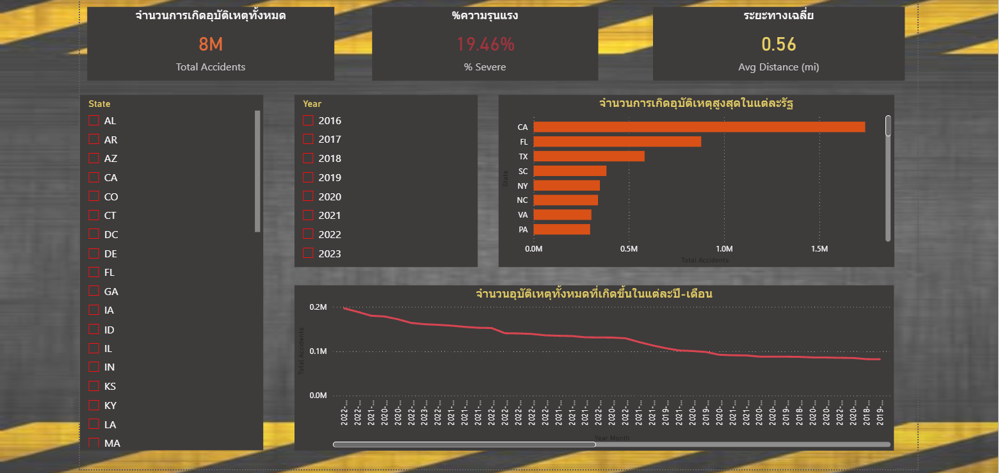
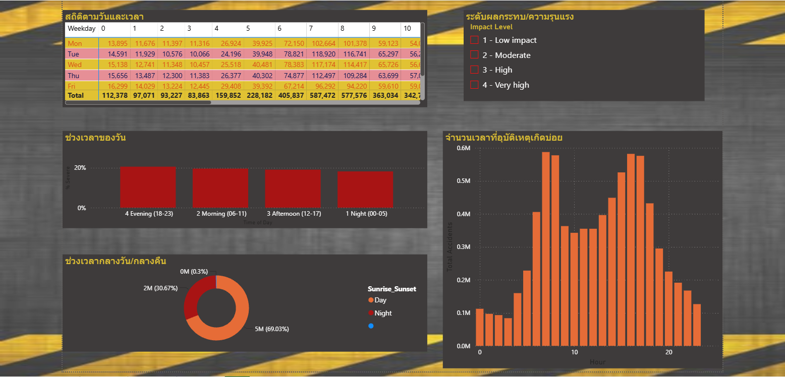
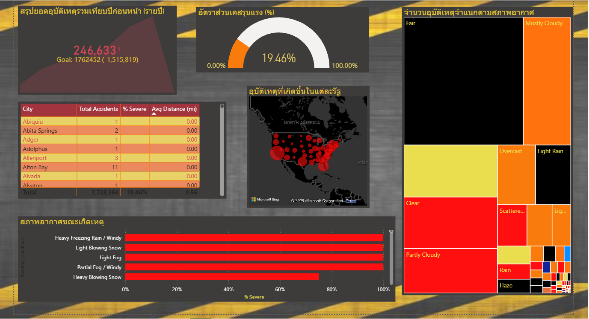

# US Accidents Analysis

Data mining (Python) and an interactive 3-page Power BI dashboard on the
[US Accidents dataset](https://www.kaggle.com/datasets/sobhanmoosavi/us-accidents)
(Kaggle) — 7.7M records.

## Dashboard

## Key findings

- 7,728,394 accident records; 19.46% are high severity
- Most accidents: California, then Florida and Texas
- About 69% happen in daytime, 31% at night
- Peaks at 7–8 AM and 4–5 PM (commute hours)

## Data model

Star schema: `Accidents` (fact) with `DimDate`, `DimSeverity`,
`DimState`, `DimWeather`.

## Files

- `data_mining_project.py` — data mining / preprocessing in Python
- `US_Accidents.pbix` — Power BI report (open with Power BI Desktop)
- `page1.png`, `page2.png`, `page3.png` — dashboard screenshots

## Data

The CSV is not included (too large). Download it from Kaggle and place it
next to the script.

## Tools

Python, Power BI, DAX
